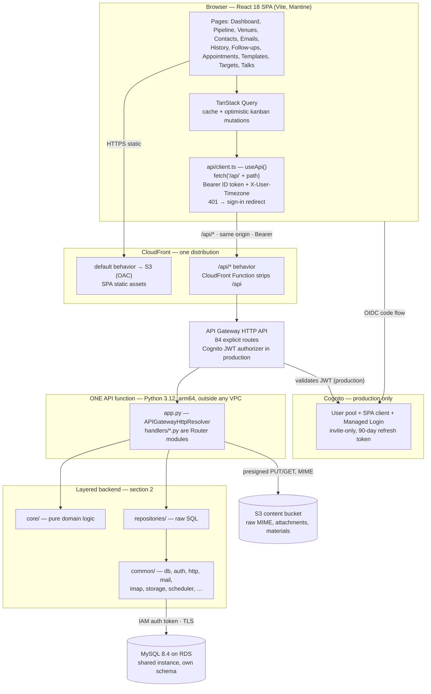
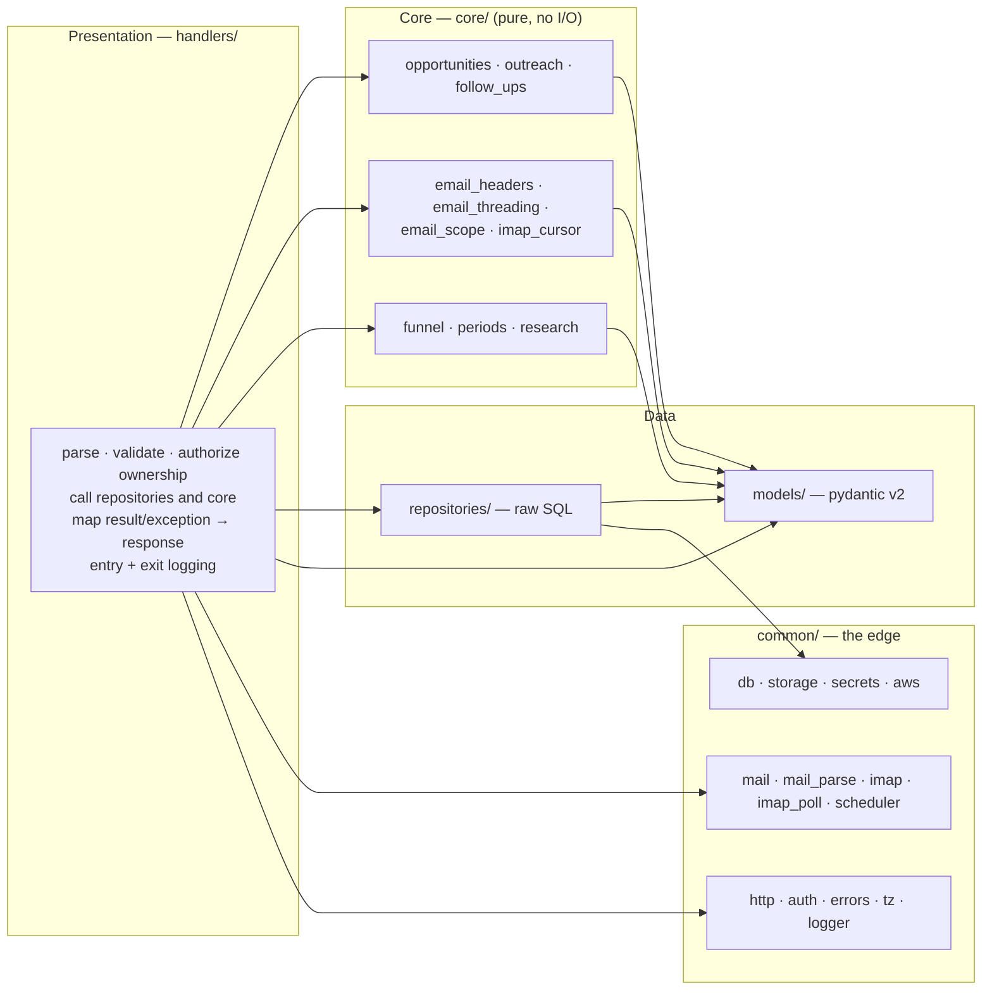
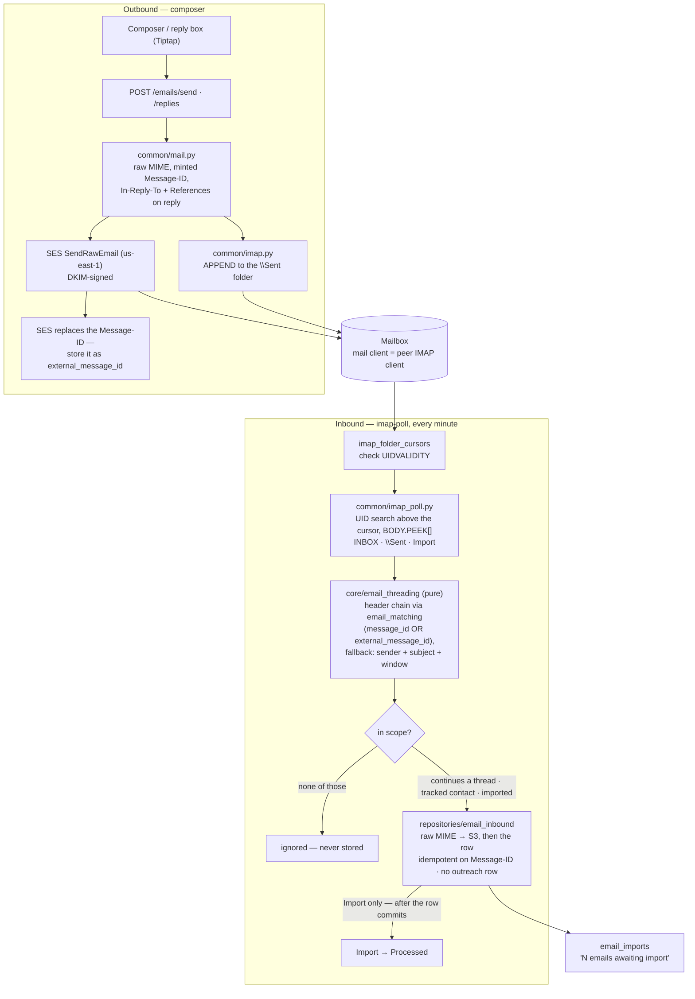
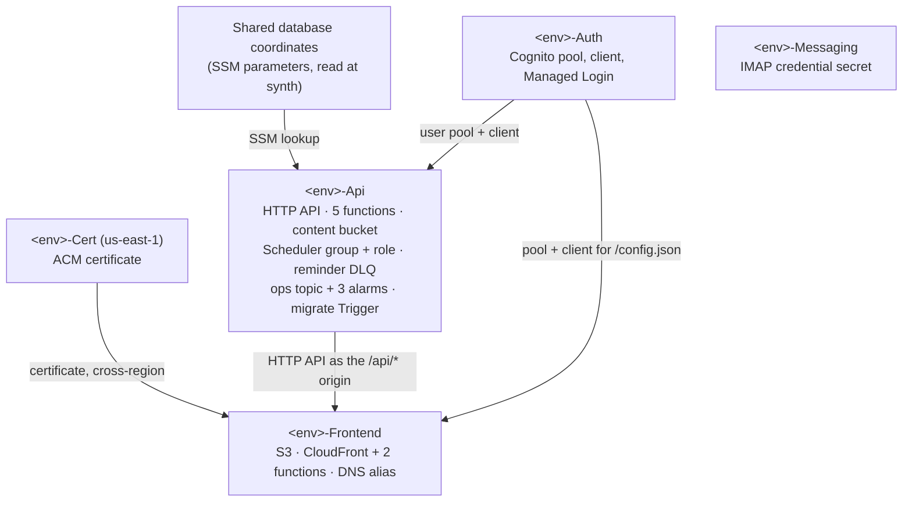

# Speaker Tracker — Architecture

How the pieces fit: the React SPA, one CloudFront distribution serving both the SPA and the API, the
Python Lambda functions, the layered backend, the email subsystem (SES, IMAP, a mail server the app
shares with the user's own mail client), and the CDK stacks that deploy it all.

Related documents: [DATABASE.md](DATABASE.md) (schema) · [OPERATIONS.md](OPERATIONS.md)
(deploying, alarms, runbooks) · [DECISIONS.md](DECISIONS.md) (why things are the way they are) ·
[CODING-GUIDELINES.md](CODING-GUIDELINES.md) · [diagrams/](diagrams/README.md).

**Contents** — [1. Request path](#1-request-path) · [2. Backend](#2-backend) ·
[3. API routes](#3-api-routes) · [4. Email](#4-email) · [5. Background work](#5-background-work) ·
[6. Infrastructure](#6-infrastructure) · [7. Frontend](#7-frontend) ·
[8. Testing and CI](#8-testing-and-ci)

---

## 1. Request path

The SPA and the API are **same-origin**: one CloudFront distribution serves both, so there is no
CORS and no environment-specific API URL baked into the frontend build.



Four more functions run outside the request path — the IMAP poller, the migration runner, and the
two halves of follow-up reminders (§5).

**Key facts**

- **Same-origin.** The browser calls `/api/...`; a CloudFront Function strips the `/api` prefix
  before API Gateway sees it.
- **Functions run outside any VPC** and reach RDS over TLS with a short-lived **RDS IAM auth token**
  minted per connection: no password in transit and no ENI cold-start penalty, at the accepted cost of
  a 2–6 s TLS handshake on a cold start.
- **One function serves every API route**, through Powertools' `APIGatewayHttpResolver` with a
  `Router` per route group. Twenty separate functions would each cold-start, and each pay that
  handshake, independently; a single occasional user would hit it on nearly every action.
- **The database connection is reused at module scope**, which the single function makes possible.
  The per-request `SET time_zone` doubles as the liveness probe; on a lost connection the code
  reconnects **once** with a fresh token. `ping(reconnect=True)` is banned — it reconnects with the
  *expired* token stored on the connection.
- **Every session runs in strict `sql_mode`** (`common/db._SQL_MODE`), set by pymysql on every
  connect. The shared instance's parameter group is not strict and is not ours to change, so without
  this a value too long for its column would be silently cut in production while CI rejected it. Each
  new connection reads the mode back and logs `Opened RDS connection sql_mode=…`, or a WARNING if
  the server did not apply it.
- **Every data request sets the session time zone** from the `X-User-Timezone` header, so `NOW()` and
  every date bucket evaluate in the user's local time. `db.db_now_local` is the app's single source
  of "now", read from the same clock that writes every stored timestamp.
- **Authentication is at the gateway** in production (§1.1). Sandbox has no Cognito: its routes are
  open and a fixed development user is injected.

### 1.1 Where authentication happens

**The authorizer is on the gateway. `common/auth.py` is not an authorizer**, despite the name.

`api-stack.ts` builds an `HttpJwtAuthorizer` (Cognito issuer + app-client audience) and attaches it
**per route** from the `ROUTES` table's `authRequired` flag. API Gateway validates the JWT *before*
invoking anything: an unauthenticated request to a protected route is rejected with 401 by the
gateway and **never reaches the function**.

`common/auth.principal_from_event` reads claims the gateway has *already verified*
(`event["requestContext"]["authorizer"]["jwt"]["claims"]`). That is identity extraction, not
authentication: its `Unauthorized` on a missing `sub` is a misconfiguration guard. If it fires in
production, a route is missing its authorizer.

**Sandbox is open, deliberately.** It deploys no Cognito, so every route falls back to
`HttpNoneAuthorizer` and the function injects a development principal. That is acceptable only
while sandbox holds disposable data. The guard against dev auth reaching production is at **import
time**:

```python
if _AUTH_MODE == "dev" and _ENV_TYPE != "sandbox":
    raise RuntimeError("AUTH_MODE=dev is only allowed when ENV_TYPE=sandbox")
```

A production function deployed with dev auth **fails its cold start** rather than serving anonymous
traffic, and both variables default to their production-safe values, so a *missing* `ENV_TYPE`
trips it too. `infra/cdk/test/authorizer.test.ts` asserts the route-level wiring.

**Send the ID token, not the access token.** `HttpJwtAuthorizer` validates `aud`; Cognito ID tokens
carry `aud = clientId`, access tokens do not. The failure mode is a blanket 401 with nothing in the
function's logs.

### 1.2 Errors and sessions

- **One error shape.** Handled and unhandled errors alike return `{"error": "<message>"}`. A
  catch-all maps unhandled exceptions to 500 after `logger.exception`, so API Gateway's own
  `{"message": "Internal Server Error"}` never reaches the SPA. Domain exceptions map explicitly
  (`NotFound` → 404, `Conflict` → 409, `InvalidInput` and any pydantic `ValidationError` → 400).
- **The SPA treats 401 as an auth event** and starts sign-in, preserving the intended path, instead
  of handing a raw `Response` to a page.
- **Every failed save and every failed load is visible.** Mutation errors show what failed, why, and
  a copyable request reference, and stay until dismissed; query errors render in place with *Try
  again* rather than as an empty state.
- **Session.** No full-screen login splash: the app lands on its normal shell with a *Sign in* link,
  and a deep link followed while signed out is restored after the redirect. The refresh token lasts
  90 days; `automaticSilentRenew` rolls the access token over with the refresh-token grant, and
  tokens live in `localStorage` so a browser restart stays signed in. That trade fits a single user
  on a fixed desktop; revisit it for multiple users or mobile.
- **Cognito is invite-only** (`selfSignUpEnabled: false`, administrator-created users,
  `removalPolicy: RETAIN`).

---

## 2. Backend

Three layers with dependencies pointing **inward**, plus a shared edge layer.



**The handler is the composition root.** It fetches what core needs from repositories, passes it to
core as **plain data**, and writes core's decision back through repositories. Core never sees a
repository, a connection or a client: `core/email_threading` receives parsed headers and candidate
rows and *returns a decision*; `common/imap` does the talking. That is what keeps `core/` testable
with no database and no mocks.

**Layer purity is enforced by ruff**, not review (§8): `core/` cannot import `boto3`, `pymysql`, the
HTTP framework or `os.environ`, and `common/` cannot import `core`, `repositories`, `handlers`,
`models` or `migrations`.

```
backend/src/
  app.py          resolver + include_router + the exception handler (HTTP composition root)
  api_handler.py  lambda_handler for the API function: entry/exit logging, metrics
  handlers/       one Router module per route group, the four other functions' entry points,
                  and edge helpers:
                    context.py    authenticate(): principal → connection → user upsert
                    params.py     path/query parsing: path_int (bad id → 404), query_choice,
                                  query_bool (only "true"/"false"; anything else → 400)
                    responses.py  detail-response composition, so no route imports a sibling
  core/           pure business logic
                    opportunities  status transitions, the closed_at predicate
                    outreach       outreach-kind inference
                    follow_ups     reminder schedule expressions
                    funnel · periods · research   ratios, period windows, research-readiness
                    email_headers  address parsing (address_list, address_domain, sender_domain,
                                   sender_address), subject and Message-ID normalization
                    email_threading  which thread a message joins
                    email_scope    whether a polled message enters the app at all
                    imap_cursor    where a poll starts reading; PollSummary
  repositories/   raw SQL, one module per aggregate
                    _ownership     owns_row + _OWNED_TABLES: "does this id belong to the caller?"
                    email_sends    outbound: the three-phase intent-first send
                    email_threads  thread reads, read/close/reopen, auto-close on gig close
                    email_matching inbound reads that feed the pure matcher
                    email_inbound  inbound write — idempotent ingest, reopen on reply
                    email_imports  the pending-import queue and its link actions
                    imap_cursors   per-folder poll watermarks
  models/         pydantic request/response models; limits.py holds the shared size caps
  migrations/     runner.py + forward-only .sql (DATABASE.md §6)
  common/         the edge
                    db         connection reuse, reconnect, strict sql_mode, transactions
                    storage    S3: presigned PUT/GET, upload_key, object reads and writes
                    mail       outbound MIME assembly + the SES call
                    mail_parse inbound parsing — headers for the poller, bodies for the thread view
                    imap       connection, auth, folder topology, Sent-folder APPEND
                    imap_poll  message-level operations: select, UID search, fetch, move
                    scheduler  EventBridge Scheduler put/delete
                    secrets    cached Secrets Manager reads
                    http · auth · errors · tz · logger · aws
```

The email modules split reads from writes on both sides (`email_sends`/`email_threads` outbound,
`email_matching`/`email_inbound` inbound), and `common/mail` vs `mail_parse` and `common/imap` vs
`imap_poll` follow the same seam.

### 2.1 Cross-cutting rules

- **Ownership.** A foreign key checks that a referenced row exists, not that it belongs to the
  caller. Every write that references another row checks it with `_ownership.owns_row` (or a
  `validate_*` wrapper that raises 400), over an allow-list of the 11 owned, soft-deleted tables.
  `tests/test_ownership.py` compares that list with the schema, so a new owned table cannot be
  forgotten. A foreign id therefore behaves exactly like a missing one.
- **Request limits.** Every request-model string has a `max_length` equal to its column width, and
  every field writing a `TEXT` column is capped at `models/limits.MAX_TEXT_CHARS` (16,000).
  `tests/test_model_widths.py` checks the caps against the migrated schema. An email may have at most
  `MAX_RECIPIENTS` (50) To + Cc recipients — SES's limit — enforced on the model, so a reply-all
  derived from a large thread is covered too.
- **Uploads never pass through the API.** The server issues a presigned PUT for a key **it**
  chooses — `common/storage.upload_key(prefix, user_id, filename)` is the one place the
  `<prefix><user_id>/<uuid>/<filename>` layout is written — the browser PUTs straight to S3
  (`frontend/src/api/uploads.ts`), and the follow-up request carries only the key. The server
  re-reads size and type from S3 rather than trusting the client. The presigned PUT signs the
  `Content-Type`, so the browser must send exactly the type it was issued.
- **Mirrored rules.** Where the frontend repeats a backend rule (fee precision, the outreach-kind
  default, material size, …) both sides carry a "mirrored in" comment naming the other.
  [CODING-GUIDELINES.md](CODING-GUIDELINES.md) lists them.

**Response envelope**: bare JSON on success (each route names its own top-level keys, no `data`
wrapper), `{"error": "<message>"}` on failure.

**Exception handling is registered on `app`, never on a `Router`** — router-level propagation has
been version-dependent. A single catch-all delegates to `common/http.response_for_exception`, an
ordered `isinstance` map that also honours Powertools' own `ServiceError.status_code`, so an
unmatched route returns 404 rather than a false 500.

**Entry/exit logging wraps `app.resolve`** in `api_handler.lambda_handler`, not a middleware:
Powertools runs exception handlers outside the middleware chain, so a middleware never sees the
mapped status. The exit line logs the true status at a level that mirrors it (5xx ERROR, 4xx
WARNING, else INFO). `log_event` is never enabled — the raw event carries the JWT.

---

## 3. API routes

Every route is a **`Router` module inside the one API function**, registered in `app.py`. The
`ROUTES` table in `infra/cdk/lib/api-stack.ts` declares all **84** path/method pairs on the HTTP API
and decides, per route, whether the JWT authorizer applies.

**Routes are explicit, not `ANY /{proxy+}`:** `/health` stays unauthenticated for uptime checks, and
the gateway rejects unknown paths itself.

| Router module | Routes |
|---|---|
| `health.py` | GET `/health` — **no authorizer** |
| `catalogs.py` | GET `/catalogs` |
| `organizations.py` | GET/POST `/organizations`, GET/PUT/DELETE `/organizations/{id}` |
| `contacts.py` | GET/POST `/contacts`, GET/PUT/DELETE `/contacts/{id}` |
| `contact_organizations.py` | POST `/contacts/{id}/organizations`, PUT/DELETE `/contacts/{id}/organizations/{orgId}` |
| `opportunities.py` | GET/POST `/opportunities`, GET/PUT/DELETE `/opportunities/{id}`, PATCH `/opportunities/{id}/status`, PATCH `/opportunities/{id}/payment`, POST `/opportunities/{id}/close`, GET `/funnel` |
| `opportunity_contacts.py` | POST `/opportunities/{id}/contacts`, PUT/DELETE `/opportunities/{id}/contacts/{contactId}` |
| `opportunity_notes.py` | POST `/opportunities/{id}/notes`, DELETE `/opportunities/{id}/notes/{noteId}` — notes are read with the opportunity detail |
| `opportunity_responses.py` | PUT `/opportunities/{id}/responses/{responseType}` — sets a counter to a value, so a repeated click is idempotent; zero is the removal |
| `outreaches.py` | POST `/outreaches`, PATCH/DELETE `/outreaches/{id}`, GET `/contacts/{id}/outreaches`, GET `/contacts/{id}/timeline` — the patch takes no `contact_id`, since moving a touch between contacts would reopen its kind inference |
| `message_templates.py` | GET/POST `/templates`, GET/PUT/DELETE `/templates/{id}`, POST `/templates/{id}/duplicate` |
| `follow_ups.py` | GET/POST `/follow-ups`, PATCH/DELETE `/follow-ups/{id}` — marking done is `{"completed": true}` on the patch, so one code path reconciles the reminder schedule for every kind of change |
| `appointments.py` | GET/POST `/appointments`, PATCH/DELETE `/appointments/{id}` — `?scope=upcoming\|past\|all`, `?contact_id=` |
| `targets.py` | GET/PUT `/targets`, DELETE `/targets/{targetType}/{cadence}` |
| `dashboard.py` | GET `/dashboard` — `?week_of=YYYY-MM-DD` moves the **target tiles only**; every other section reports on now |
| `emails.py` | GET `/emails/threads` (`?include_closed=`), GET `/emails/threads/{id}`, POST `/emails/send`, POST `/emails/attachments` (presigned upload), POST `/emails/threads/{id}/replies`, POST `/emails/threads/{id}/read` \| `/close` \| `/reopen` — verbs, not a PATCH, because each is a distinct transition (closing a closed thread is a 404) |
| `email_imports.py` | GET `/emails/imports`, PUT `/emails/threads/{id}/contact`, PUT `/emails/threads/{id}/opportunity` — PUT because they set a property, so re-sending the same value succeeds |
| `image_senders.py` | GET/PUT/DELETE `/image-senders` — senders whose remote images load automatically |
| `talks.py` | GET/POST `/talks`, GET/PUT/DELETE `/talks/{id}` |
| `materials.py` | GET/POST `/materials`, POST `/materials/upload-url`, PUT/DELETE `/materials/{id}`, PUT `/materials/{id}/file` (replace the bytes, keeping id, name and talk), GET `/materials/{id}/url` (presigned GET; `?disposition=attachment` to download) |
| `signatures.py` | GET/POST `/signatures`, PUT/DELETE `/signatures/{id}`, GET `/signatures/default` |

**History has no handler.** It is closed opportunities — `GET /opportunities?closed=true`, and the
same detail route as any gig.

**The board payload is one flat list** that the SPA buckets by `current_status`, which keeps
optimistic-drag cache updates simple. Column order and labels come from `GET /funnel`, so no stage
name is hardcoded in the SPA.

**Boolean query parameters accept exactly `true` or `false`** (`params.query_bool`); anything else is
a 400 rather than silently read as false. The Pipeline *page* has a `closed=all` URL value of its
own, which it translates before calling the API.

**Duplicate detection is a query, not an endpoint**: the "this person may already exist" step is
`GET /contacts?q=`.

---

## 4. Email

The most involved part of the app. The user reads and writes their business mail in an ordinary mail
client over IMAP; the app works on **the same mailbox**, server-side, so the two stay in sync. The
mail client is a peer, not something the app reads through.

### 4.1 Topology

The mailbox (Amazon WorkMail) lives in a **different AWS account** from the app. That costs nothing,
for two independent reasons — no cross-account IAM, no role assumption, no sending-authorization
policy:

- **Sending** uses an SES **domain identity** for the business domain, verified with DKIM in the
  app's account in **us-east-1**. Domain verification covers every address on the domain, so the
  app can send as the user's address with no per-address identity. The SES client is constructed
  for us-east-1 while the functions run in us-west-2 — a client argument, not an architectural seam.
  The identity is **referenced, never created**, by CDK: it was verified outside CDK and other
  senders on the domain depend on it.
- **IMAP is username/password**, not IAM, so reaching the mailbox is a credential concern, not an
  account-boundary one.

The account ids, mailbox and identity names live in `infra/cdk/lib/config.ts`.



### 4.2 Outbound

A send writes a **pending** row, calls SES, then confirms (§5.2 explains why). The minted
`Message-ID` is derived from a client **idempotency key** held constant for the life of a draft, so a
retry after an ambiguous failure hits `UNIQUE(user_id, message_id)` and returns **409** instead of
sending twice. SES replaces that header on the way out, so both ids are stored
([DATABASE.md](DATABASE.md#email_messages)) and replies are matched against either.

The Message-ID's domain and the inline-image Content-IDs both use the sender's domain
(`core.email_headers.sender_domain`); a sender address with no domain fails before anything is
written. The SES envelope uses bare, de-duplicated addresses while the headers keep display names, so
someone in both To and Cc gets one copy.

After a successful send the message is appended to the mailbox's Sent folder — discovered by its
`\Sent` SPECIAL-USE flag, never assumed by name — so it shows in the user's mail client.

An email attachment is **a copy of the bytes, never a link**: a library material attached to a
message is copied into the MIME, so replacing the material later never changes mail already sent.

### 4.3 Inbound — the poller

**Scope: two consented surfaces, never the whole mailbox.** (a) correspondence with a tracked
contact, matched on the `(user_id, email)` index, or continuing a thread the app already has; (b)
messages the user explicitly moved into the mailbox folder `Speaker Tracker/Import`. Everything
else is ignored at the poller, not filtered later. The thread match runs *before* the scope check,
because continuing a known conversation is itself grounds to ingest — that is how a reply from
someone who is not yet a contact still lands.

**Importing an unknown sender.** In the mail client, the user drags a message into
`Speaker Tracker/Import`. The poller stores it with no contact or gig, moves it to
`Speaker Tracker/Processed` (never polled), and the app shows *"N emails awaiting import"*, which
opens *Add contact* prefilled from the sender. A folder **move** rather than a forward keeps the
original message byte-for-byte, so its `Message-ID` survives and the reply threads correctly at the
other end.

**Folders are created by the app, never typed.** On every poll the poller lists, and if missing
creates **and subscribes**, `Speaker Tracker/Import` and `Speaker Tracker/Processed` — an
unsubscribed folder may not appear in the mail client, which looks exactly like a folder that was
never created.

**Ordering that is not interchangeable.** An imported message is ingested and committed *before* it
is moved out of Import; moving first would file it into Processed, which nothing reads, with no row
behind it.

**Non-negotiables for a one-minute interval:**

- A **per-folder cursor** (`imap_folder_cursors`), with `UIDVALIDITY` checked and the cursor reset if
  it changed — stale UIDs either re-import everything or skip mail forever.
- **Idempotent ingest**: `UNIQUE(user_id, message_id)` makes a re-delivered or re-imported message a
  duplicate, not a second row, and raw MIME is written to S3 *before* the row, so a row never points
  at a missing object. Reserved concurrency 1 prevents pile-up; it is not what makes overlap safe.
- The IMAP credential is **cached at module scope**, not fetched every minute, and every path
  **logs out** in a `finally` — the mail server caps simultaneous connections per mailbox and the
  user's own client already holds some.
- A poll reads at most a capped number of messages and defers the rest to later polls.

### 4.4 Poller failure modes

The project's worst failure is a poller that keeps running, finds nothing, and stops threading mail
with no error anywhere. Failures are separated **by type**, not by log text:

| Failure | Handling | Signal |
|---|---|---|
| **Credentials refused** (`ImapAuthError`, after one retry with a freshly fetched secret) | The invocation fails | Lambda `Errors` → `imap-poll-failures` alarm |
| **Transient connection trouble** — unreachable host, timeout, or a login the server rejects as temporary (`[UNAVAILABLE]` and the other `TRANSIENT_LOGIN_CODES`) | Logged at WARNING; the whole poll waits for the next minute | none — a minute of delay costs nothing |
| **One message or folder keeps failing** — a message that will not ingest or move, a folder that will not open | Logged at ERROR with a `poll_stuck` key; that folder's cursor holds so the message is retried, while the other folders carry on | `imap-poll-stuck` alarm after ~15 minutes of steady failure |

**An unrecognised login rejection counts as an auth failure**: a false alarm is recoverable, a
silenced one is exactly the failure this table exists to prevent.

**A stuck message jams its folder deliberately.** Skipping it would lose mail silently; holding it
means no later mail in that folder is processed until someone looks, which is why it alarms. The
same rule covers the IMAP `MOVE` fallback: on a server without `MOVE`, the poller copies, flags
`\Deleted` and expunges, and a copy or flag that fails raises, so the cursor holds and the move is
retried rather than leaving the original behind in Import. What to do when either alarm fires is in
[OPERATIONS.md](OPERATIONS.md).

### 4.5 Threads

- **Threading uses RFC 5322 headers only** — `Message-ID`, `In-Reply-To`, `References` — with a
  guarded fallback on sender + normalized subject + time window when a client breaks the chain.
  Microsoft's proprietary `Thread-Index` is not used.
- **Thread state** is *sent* or *received* (who wrote last) plus *unread* (received after it was last
  opened). There is no *replied* state: nothing in the data distinguishes a reply that answers from
  one that does not.
- **Closing.** The user can close a thread ("no reply needed"), and a thread closes automatically
  when its gig moves from open to closed — only on that transition, so a thread the user reopened is
  not re-closed by a later edit to the gig. **An inbound reply reopens a closed thread** when it is
  the thread's newest message, so a reply is never buried.
- **The inbox lists open threads**; *Show closed* (`?closed=all`) includes closed ones, and searching
  or filtering by contact always includes them, so history is never more than a search away.
- **Received mail is sanitized and contained.** Bodies are rebuilt from the stored MIME and rendered
  through DOMPurify inside their own card; links open in a new tab without a referrer; inline images
  are kept except SVG. **Remote images are held back** — loading one tells the sender the message
  was opened, when, and from where — until the user allows them for one message or always for that
  sender (`image_trusted_senders`, keyed by full address).

### 4.6 The IMAP credential

CDK owns the Secrets Manager **resource** (tags, `RETAIN`, read grants to the poller and to the API
function, which appends sent mail to the mailbox); the **value** is written once, outside CDK.
Reading it from a config file at synth time would force `SecretValue.unsafePlainText()`, embedding the
password in the synthesized template, the CDK staging bucket and CloudFormation. The secret does
**not** rotate. How to set it is in `docs/OPERATIONS.local.md` (not in the repository).

---

## 5. Background work

| Trigger | Function | Purpose |
|---|---|---|
| EventBridge rule, `rate(1 minute)` — enabled in **one** environment only | `imap-poll` | Reply threading and imports (§4) |
| EventBridge Scheduler, one-shot `at()` per follow-up | `followup-notify` | The due-date reminder email |
| SQS (the reminders' dead-letter queue) | `followup-failed` | Record and alarm on a reminder that gave up |
| CDK `Trigger`, during each deploy | `migrate` | Apply pending migrations; a failure fails the deploy |

**Exactly one environment polls the mailbox.** Two pollers would race over the Import folder, and a
dragged message would land in one database at random. Production polls; sandbox's rule is deployed
disabled, so the function can still be invoked by hand. A CDK test pins this.

### 5.1 Follow-up reminders

```
EventBridge Scheduler ──invoke──> followup-notify ──> SES          (no database)
        │                               │
        │                   5 attempts over 2 hours
        │                               ↓
        └──────────────> <app>-<env>-followup-failures (SQS)
                                        ↓
                         followup-failed ──> follow_ups.reminder_failed_at
                                        ↓
                    alarm on this function's invocations ──> SNS ──> email
```

- **One schedule per follow-up**, named deterministically `followup-<id>` (`common/scheduler.py`), so
  create, update and delete need no state read-back; a missing schedule on cancel is ignored,
  because a one-shot schedule may already have fired and self-deleted.
- **Local time, no UTC arithmetic.** The schedule expression is the user's wall-clock time with
  their IANA zone in `ScheduleExpressionTimezone`.
- **`followup-notify` never touches the database.** Everything the email needs travels in the
  schedule payload, so editing a follow-up cancels and recreates its schedule. The reminder is
  **one email**; it does not complete the follow-up, which stays pending until the user marks it
  done.
- **The retry budget is 5 attempts over 2 hours**, not EventBridge's default of 185 over a day: a
  morning nudge delivered after lunch has missed its purpose, and 185 attempts against a bad address
  hurt the sending reputation.
- **The queue is a dead-letter destination only** — nothing feeds it on the happy path, hence the
  name `-followup-failures`. `followup-failed` sets `reminder_failed_at`, so the app shows *reminder
  didn't send* on the follow-up; it is the only part of the reminder path with database access.
- **The alarm watches the consumer's invocations, not queue depth.** A message consumed within
  seconds may never be visible at an alarm evaluation; an invocation *means* a reminder failed.
- `common/scheduler.py` **no-ops with a WARNING** when its environment variables are missing, so the
  API keeps working if the scheduler resources are absent.

### 5.2 Dual writes we accept

Three operations commit to the database **and** to something outside it. None is atomic:

| # | The pair | If the second half fails | Mitigation |
|---|---|---|---|
| 1 | `follow_ups` row → EventBridge schedule | Row exists, no reminder will fire | Logged at WARNING |
| 2 | `email_messages` row → SES send | Depends on how SES fails (below) | Intent-then-confirm, compensation only on clean rejection, a client idempotency key |
| 3 | SES send → the rider's `follow_ups` row | Email sent, no reminder set | Logged; the send still succeeds |

**#2 in full** (`handlers/emails._deliver`):

| SES outcome | Result |
|---|---|
| Clean rejection (`ClientError`) | Pending row discarded, error returned — nothing sent, nothing recorded |
| Sent, then the confirm write fails | Row stays pending, logged loudly — recorded but unconfirmed |
| **Ambiguous** — timeout, dropped response (`BotoCoreError`) | Pending row **kept**, logged at ERROR — delivery unknown |

botocore's two exception roots decide it: a `ClientError` means SES received the request and refused
it, so compensation is safe; anything else means delivery is unknown, and discarding the row would
erase the only record of a message that may already be in someone's inbox.

**The rule everywhere else: the database commits first, the outside effect second.** A missing side
effect is quiet and fixable by hand; a side effect with no row behind it is actively wrong — a
reminder about a follow-up that does not exist, or a schedule nobody can cancel.

**A general fix is not worth it here.** A transactional outbox would make all three reliable at the
cost of a dispatcher, at-least-once delivery and idempotent consumers. For one user, whose worst
case is one reminder not set on a day they can see the email in the thread anyway, that is more
machinery than the failure justifies. More users, or reminders that chase money, would change that.

---

## 6. Infrastructure

One TypeScript CDK app (`infra/cdk`), parameterized per environment in `lib/config.ts`. Stacks
reference each other's constructs directly — no SSM plumbing between our own stacks. The shared RDS
instance is **referenced** from SSM parameters its owning project publishes, never constructed here.



`Messaging` imports and exports nothing; the API function and the poller read its secret by name.

**Stack ids are `<app>-<env>-<Role>`** (for example `speaker-tracker-prod-Api`). Sandbox deploys
three stacks; production adds `Auth` and `Cert`.

| Stack | Region | Contents | Environments |
|---|---|---|---|
| `Auth` | us-west-2 | Cognito user pool (Essentials plan, invite-only), SPA client, Managed Login branding | production |
| `Cert` | **us-east-1** | ACM certificate for the app's domain (CloudFront requires us-east-1), DNS-validated | production |
| `Messaging` | us-west-2 | The IMAP credential secret (resource only — §4.6) | both |
| `Api` | us-west-2 | HTTP API + JWT authorizer (production), the five functions, the content bucket, the 1-minute poll rule, the Scheduler group and its invoke role, the reminder dead-letter queue, the ops SNS topic and its three alarms, the migrate `Trigger` | both |
| `Frontend` | us-west-2 | Private SPA bucket (OAC), CloudFront with the S3 and `/api/*` origins and two CloudFront Functions, `/config.json`, the DNS alias (production) | both |

**Sandbox** deploys no Cognito, certificate or DNS record: it serves from the default
`*.cloudfront.net` domain with an open gateway (`ENV_TYPE=sandbox`, `AUTH_MODE=dev`) and its poll
rule disabled.

Deploy commands, ordering and post-deploy checks are in [OPERATIONS.md](OPERATIONS.md). **`Api` and
`Frontend` deploy together** — §6.2 explains why.

### 6.1 Functions

| Function | Memory | Timeout | Reserved concurrency | Trigger |
|---|---|---|---|---|
| `api` | 1024 MB | 15 s | 5 in production, none in sandbox | API Gateway |
| `migrate` | 512 MB | 300 s | 1 in production, none in sandbox | CDK `Trigger` on deploy |
| `imap-poll` | 512 MB | 120 s | 1 | EventBridge rule, every minute |
| `followup-notify` | 256 MB | 30 s | none | EventBridge Scheduler |
| `followup-failed` | 512 MB | 30 s | none | SQS, batch size 1 |

All are Python 3.12 on arm64, built from one backend bundle, each with its own log group.
1024 MB for the API is deliberate: CPU scales with memory, so imports and pydantic run roughly twice as
fast as at 512 MB for about the same cost. Reserved concurrency 5 bounds connections to the shared
micro instance, and the 15 s timeout stays under API Gateway's 30 s integration limit, so the
function's own timeout is the one that reports. No provisioned concurrency — it is not worth paying to
save one user a cold start.

### 6.2 Alarms

All three publish to **one** SNS topic, `<app>-<env>-ops-alerts`, with an email subscription. One
topic on purpose: a confirmed subscription is the only thing between an alarm and a person, and each
extra topic is another confirmation link that someone must remember to click.

| Alarm | Watches | Fires on |
|---|---|---|
| `imap-poll-failures` | Lambda `Errors` on the poller | any error in 5 minutes (credentials refused) |
| `imap-poll-stuck` | log metric filter `{ $.poll_stuck = "*" }` → `SpeakerTracker/ImapPoll` `StuckPolls-<env>` | ≥ 3 in each of 3 consecutive 5-minute periods |
| `followup-failures` | invocations of `followup-failed` | any invocation in 5 minutes |

Each alarm treats missing data as not breaching, so a quiet minute is not a failure, and each
description says what to check. The metric name carries the environment because both environments
share an account and region.

### 6.3 CDK details that are easy to get wrong

- **Do not use `Distribution.errorResponses` for the SPA fallback.** It is distribution-wide, so a
  `403 → /index.html` mapping would also turn the API's real 401s and 404s into an HTML page with
  status 200, and the SPA's 401 handling would never fire. A CloudFront Function on the **default
  behavior only** rewrites extension-less paths to `/index.html`; a second one strips `/api` on the
  API behavior. Both are plain `.js` files with their own tests.
- **Host header.** `/api/*` uses `OriginRequestPolicy.ALL_VIEWER_EXCEPT_HOST_HEADER`, forwarding
  `Authorization` and `X-User-Timezone` while letting API Gateway see its own hostname, paired with
  `CACHING_DISABLED`.
- **`Api` and `Frontend` deploy together.** The Frontend's `/api/*` origin is the Api stack's HTTP
  API. `cdk.json` deliberately sets `defaultCrossStackReferences` to **strong** (`Fn::ImportValue`):
  with the recommended weak references the consumer's template never changes when the producer's
  output does, and a recreated API left CloudFront pointing at a deleted gateway while every deploy
  reported success. `test/cross-stack-refs.test.ts` guards it.
- **Hosted zone by attributes, not `fromLookup`.** With no context lookups, `cdk synth` needs no AWS
  credentials, which is what lets the CI infra job run.
- **Lambda resource-policy size.** Integrations use `scopePermissionToRoute: false` — one
  API-scoped permission instead of one per route, which overflowed the 20 KB resource-policy limit at
  58 routes. A test guards the size.
- **Managed Login, not the classic Hosted UI.** It needs the Essentials plan and an explicit
  `CfnManagedLoginBranding` resource; without branding the sign-in page can render unstyled.

### 6.4 Observability and configuration

- **Logs.** Structured JSON (Powertools Logger) everywhere, with a correlation id on every request and
  paired entry/exit lines carrying `duration_ms`. Secrets and raw events are never logged.
- **Metrics.** Powertools Metrics (CloudWatch EMF, namespace `SpeakerTracker`) on the API handler,
  including a cold-start metric. EMF writes metrics as log lines — no added latency, no
  `PutMetricData`.
- **Tracing** is wired but disabled (`POWERTOOLS_TRACE_DISABLED=true`); turn it on per environment
  when investigating.
- **Configuration vs secrets.** Everything except the IMAP credential is an environment variable
  resolved at deploy time. The IMAP credential is the only runtime secret (`common/secrets.py`,
  cached). Sending needs no credential — SES is IAM-authorized.

---

## 7. Frontend

```
frontend/src/
  pages/        one per route
  components/   AppShell, the *FormModal family, EmailComposer, AttachmentPicker,
                FollowUpRiderFields, QueryError and MutationErrorMessage (FormError), SafeHtml,
                the detail cards
  api/          client.ts (useApi) + one hook module per resource; uploads.ts (presigned upload)
  auth/         session seam + its two implementations (development, OIDC), runtime config
                (/config.json), deep-link restore
  urlFilters.ts useFilterParams — every list page keeps its filters in the query string
  dates.ts      date parsing/formatting; format.ts money; emailHtml.ts received-mail sanitizing
```

| Path | Page |
|---|---|
| `/` | Dashboard — target tiles, funnel, money, Needs attention, Coming up, Follow-ups due |
| `/pipeline` | Kanban board (dnd-kit) |
| `/pipeline/{id}` | Opportunity detail — fields, contacts, notes, lifecycle, response counters |
| `/venues`, `/venues/{id}` | Organizations, with the research panel |
| `/contacts`, `/contacts/{id}` | Contacts, with affiliations, activity timeline, follow-ups and appointments |
| `/emails`, `/emails/{threadId}` | Inbox and thread view with inline reply; signature settings |
| `/history` | Closed gigs — a closed gig opens at `/pipeline/{id}` like any other |
| `/follow-ups` | Reminders, including completed ones |
| `/appointments` | Logged meetings; upcoming and past |
| `/templates`, `/targets`, `/talks` | Message templates, targets, talks and materials |

**TanStack Query owns server state.** The optimistic kanban drag (move card → `PATCH
/opportunities/{id}/status` → roll back on failure) is why it is not optional. Mutations invalidate
by each resource's key factory, never by string literal, so a renamed key cannot silently stop a
refresh. Window-focus refetching is off, so every write must invalidate what it changes.

**Server-owned ordering.** Stage order, labels and funnel composition come from `/catalogs` and
`/funnel`; the frontend never hardcodes a stage name.

**Look.** Light theme by default; sans-serif throughout; the brand is carried by colour — navy
`#1F3B4D` nav rail and headings, terracotta `#C2483A` primary actions, gold `#D9A02C` accents,
cream `#FBF8F2` background.

---

## 8. Testing and CI

**Backend** (`backend/tests/`, pytest):

- **The test schema is built by the real migration runner** against an empty database — every
  DB-backed test starts from dropped tables — so the test schema cannot drift from production.
  `run_migrations(connection, directory)` takes both as parameters for exactly this reason.
- DB-backed tests run against **`mysql:8.4`**, matching RDS: 8.0 differs on utf8mb4 collation
  defaults. They **skip** when `TEST_DATABASE_URL` is unset, so `pytest` still runs without Docker.
  Tests inherit the server's strict mode, and `tests/test_db.py` checks `common/db._SQL_MODE` equals
  it, so production and CI cannot drift apart.
- `core/` is pure, so its tests need no database and no mocks. Outside edges (IMAP, SES, S3) are
  faked at the seam — `tests/fake_imap.py` reproduces protocol quirks rather than a convenient
  version of them.
- Schema guards: `test_model_widths.py` (request caps vs column widths), `test_ownership.py` (the
  owned-table list vs the schema).

**Layer purity is enforced by ruff.** `backend/src/core/.ruff.toml` bans `boto3`, `pymysql`, the HTTP
framework and `os.environ` in core; `backend/src/common/.ruff.toml` bans `core`, `repositories`,
`handlers`, `models` and `migrations` in common.

**Frontend**: `tsc` and vitest (run in `TZ=Pacific/Honolulu`, so date bugs that only show far from
UTC show up). **Infra**: jest over the synthesized stacks — authorizer wiring, the single poller, the
alarms and their topic, cross-stack references, the policy-size guard, the CloudFront Functions.

**CI** (`.github/workflows/ci.yml`) runs on pull requests and on pushes to `main` and `slices/**`:

| Job | Steps |
|---|---|
| backend | `ruff check`, `ruff format --check`, a grep that bans `Connection.ping()`, `pytest` against a `mysql:8.4` service |
| frontend | typecheck, vitest, production and sandbox builds |
| infra | typecheck, `cdk synth --all` (credential-free, builds the real Lambda bundle), jest |

**There is no deploy step.** Deploys are manual — see [OPERATIONS.md](OPERATIONS.md).