# Speaker Tracker — Database Schema

**MySQL 8.4**, one schema (`speakertracker`) on a small RDS instance shared with sibling apps, reached
over TLS with IAM database authentication. Every table is `ENGINE=InnoDB DEFAULT CHARSET=utf8mb4
COLLATE=utf8mb4_0900_ai_ci` (one column-level exception, §5).

**The schema is exactly what `backend/src/migrations/0001`–`0016` build.** This document describes
it and explains why it is shaped that way; when the two disagree, the migrations win and this file
is the bug. Migrations are applied by `migrations/runner.py` (§6).

> **Large payloads live in S3, not here.** The raw MIME of every email and every uploaded file is an
> S3 object; the database holds only its key. The instance is small and shared, and a `MEDIUMTEXT`
> of raw MIME per message would exhaust it faster than everything else combined. Keep it that way.

**Contents** — [Conventions](#conventions) · [1. ER diagram](#1-er-diagram) ·
[2. Tables](#2-tables) · [3. Catalog vocabularies](#3-catalog-vocabularies) ·
[4. Stored vs computed](#4-stored-vs-computed) · [5. Deliberate deviations](#5-deliberate-deviations)
· [6. Migrations](#6-migrations)

---

## Conventions

- **Keys and timestamps.** Every table has `id BIGINT AUTO_INCREMENT` as its primary key and a
  `created_at`. Every table except `status_events` and `image_trusted_senders` (both write-once) also
  has `updated_at … ON UPDATE CURRENT_TIMESTAMP`.
- **Foreign keys never cascade.** Every FK uses MySQL's default (`RESTRICT`), deliberately: deleting
  a parent must fail loudly rather than silently take children with it. The only `ON DELETE` clauses
  in the schema are two `SET NULL`s on `outreaches` (its template and its email message, §2).
- **Catalog tables, not ENUMs.** Every vocabulary is a table sharing
  `id / short_name UK / description / sort_order / created_at / updated_at / deleted_at`, seeded by
  `INSERT … ON DUPLICATE KEY UPDATE`. Repositories resolve `short_name ↔ id` at the boundary, so
  callers pass `short_name`. Two deliberate exceptions are in §5.
- **Money** is `DECIMAL(10,2)`, never `FLOAT`.
- **Strict `sql_mode`.** Every connection sets MySQL 8.4's default strict mode itself
  (`common/db._SQL_MODE`): a value that does not fit its column is an error, never a silent
  truncation. The shared instance's parameter group is *not* strict and is not ours to change, so the
  session setting is what keeps production behaving like CI. Each new connection logs the mode the
  server actually applied, and a WARNING if it differs.
- **Column widths are a contract with the request models.** Every `max_length` on a request model
  equals its column's width, and every field writing a `TEXT` column is capped at
  `models/limits.MAX_TEXT_CHARS` (16,000 characters — `TEXT` holds 65,535 *bytes*, and utf8mb4 uses up
  to 4 per character). `tests/test_model_widths.py` reads the widths from the migrated schema and
  fails on any drift, so an overlong value is a 400 before any SQL runs. `MEDIUMTEXT` needs no cap:
  the request size limit is far below it.

### Ownership and lifecycle

Tenancy is by `user_id`, even though the app has one user today — it costs nothing now and is
painful to retrofit. Rows reach the API only through owner-scoped queries, and a foreign key checks
*existence*, not *ownership*, so every write that references another row first checks it belongs to
the caller (`repositories/_ownership.owns_row`). An id that exists but is someone else's is
indistinguishable from one that does not exist.

| Lifecycle | Tables |
|---|---|
| **Owned, soft-deleted** (`user_id` + `deleted_at`) — exactly `_ownership._OWNED_TABLES` | `organizations`, `contacts`, `talks`, `materials`, `opportunities`, `opportunity_notes`, `outreaches`, `email_threads`, `signatures`, `follow_ups`, `appointments` |
| **Shared or owned, soft-deleted** — `user_id` NULL means shared | `message_templates` |
| **Owned, append-only** — never updated or deleted | `status_events` |
| **Owned, immutable once stored** | `email_messages` |
| **Owned, hard-deleted or upserted in place** | `targets` (upsert key), `opportunity_responses` (a counter), `image_trusted_senders` (presence is the fact), `imap_folder_cursors` (a watermark) |
| **Join tables, hard-deleted** — no `user_id`; tenancy comes from both parents | `contact_organizations`, `opportunity_contacts` |
| **Tenant root** | `users` (soft-delete column, never used) |
| **Catalogs** | the 12 vocabularies in §3 |
| **Runner bookkeeping** | `schema_migrations` (§6) |

Soft-deleted rows are filtered by `deleted_at IS NULL` in every read; nothing is ever un-deleted
through the API.

---

## 1. ER diagram

Catalog tables are drawn separately (§1.2) to keep the entity graph legible.

### 1.1 Entities

```mermaid
erDiagram
    users ||--o{ organizations : owns
    users ||--o{ contacts : owns
    users ||--o{ opportunities : owns
    users ||--o{ outreaches : owns
    users ||--o{ email_threads : owns
    users ||--o{ follow_ups : owns
    users ||--o{ appointments : owns
    users ||--o{ targets : owns
    users ||--o{ talks : owns
    users ||--o{ materials : owns
    users ||--o{ signatures : owns
    users ||--o{ imap_folder_cursors : owns
    users ||--o{ image_trusted_senders : owns
    users ||--o{ message_templates : "owns (NULL = shared)"

    organizations ||--o{ contact_organizations : "affiliations"
    contacts ||--o{ contact_organizations : "affiliations"
    organizations ||--o{ opportunities : "hosts"

    opportunities ||--o{ opportunity_contacts : "people on this gig"
    contacts ||--o{ opportunity_contacts : "gigs"
    opportunities ||--o{ opportunity_notes : "dated notes"
    opportunities ||--o{ status_events : "transitions"
    opportunities ||--o{ opportunity_responses : "audience responses"
    opportunities }o--o| talks : "talk_id (which talk offered)"

    contacts ||--o{ outreaches : "outbound touches"
    opportunities ||--o{ outreaches : "optional attribution"
    outreaches }o--o| email_messages : "email_message_id (SET NULL)"
    outreaches }o--o| message_templates : "message_template_id (SET NULL)"

    email_threads ||--o{ email_messages : "messages"
    email_threads }o--o| contacts : "contact_id (NULLABLE)"
    email_threads }o--o| opportunities : "opportunity_id (NULLABLE)"

    contacts ||--o{ follow_ups : "reminders"
    opportunities ||--o{ follow_ups : "reminders"
    contacts ||--o{ appointments : "meetings"

    talks ||--o{ materials : "files (talk_id nullable)"

    users {
        bigint id PK
        varchar cognito_sub UK
        varchar email
        varchar display_name
        varchar timezone "default Pacific/Honolulu"
    }
    organizations {
        bigint id PK
        bigint user_id FK
        bigint organization_type_id FK
        varchar name "unique per user among live rows"
        varchar location
        varchar website_url
        varchar email_domain "import: suggest org from sender"
        text what_it_is "research"
        text why_it_fits "research"
        text how_to_approach "research"
        text notes
        timestamp research_ready_at "first crossing; never re-stamped"
        timestamp deleted_at
    }
    contacts {
        bigint id PK
        bigint user_id FK
        bigint warmth_tier_id FK
        varchar name
        varchar email "indexed - poller matches From"
        varchar phone
        varchar source
        text how_you_know
        text notes
        timestamp deleted_at
    }
    contact_organizations {
        bigint id PK
        bigint contact_id FK
        bigint organization_id FK
        varchar title "role AT THIS ORG"
        bool is_primary "default contact for the org"
        bool is_power_partner "power partner AT THIS venue"
    }
    opportunities {
        bigint id PK
        bigint user_id FK
        bigint organization_id FK
        bigint talk_id FK "nullable"
        bigint opportunity_format_id FK
        bigint current_status_id FK "denorm"
        bigint comp_type_id FK
        bigint payment_status_id FK
        varchar title
        date event_date
        decimal fee_amount "10,2"
        char currency "3, default USD"
        date paid_on
        text angle
        text outcome
        timestamp closed_at "denorm - see section 4"
        timestamp deleted_at
    }
    opportunity_contacts {
        bigint id PK
        bigint opportunity_id FK
        bigint contact_id FK
        bigint contact_role_id FK
        bool is_primary "lead on this gig"
    }
    opportunity_notes {
        bigint id PK
        bigint user_id FK
        bigint opportunity_id FK
        mediumtext body
        timestamp occurred_at
        timestamp deleted_at
    }
    status_events {
        bigint id PK
        bigint user_id FK
        bigint opportunity_id FK
        bigint status_id FK
        text note "close reason"
        timestamp occurred_at
    }
    opportunity_responses {
        bigint id PK
        bigint user_id FK
        bigint opportunity_id FK
        bigint opportunity_response_type_id FK
        int response_count "CHECK >= 0"
    }
    outreaches {
        bigint id PK
        bigint user_id FK
        bigint contact_id FK
        bigint opportunity_id FK "nullable"
        bigint outreach_kind_id FK
        bigint outreach_channel_id FK
        bigint message_template_id FK
        bigint email_message_id FK
        text note
        timestamp occurred_at
        timestamp deleted_at
    }
    email_threads {
        bigint id PK
        bigint user_id FK
        bigint contact_id FK "NULLABLE"
        bigint opportunity_id FK "NULLABLE"
        varchar subject_normalized
        enum last_direction "out|in"
        timestamp last_message_at
        timestamp last_read_at "NULL = never opened"
        timestamp closed_at "explicit - no reply needed"
        timestamp deleted_at
    }
    email_messages {
        bigint id PK
        bigint user_id FK
        bigint thread_id FK
        bigint contact_id FK "NULLABLE"
        bigint opportunity_id FK "NULLABLE"
        varchar message_id "UK with user_id - the id WE mint"
        varchar external_message_id "NULLABLE - the id the RECIPIENT sees"
        varchar in_reply_to
        text message_references
        enum direction "out|in"
        varchar subject
        varchar from_addr
        text to_addr
        text cc_addr
        varchar s3_key "raw MIME"
        varchar imap_folder
        bigint imap_uid
        timestamp sent_at
        timestamp received_at
    }
    imap_folder_cursors {
        bigint id PK
        bigint user_id FK
        varchar folder_name "UK with user_id"
        bigint uid_validity
        bigint last_seen_uid
        timestamp last_polled_at
    }
    image_trusted_senders {
        bigint id PK
        bigint user_id FK
        varchar sender_address "utf8mb4_bin, UK with user_id"
    }
    follow_ups {
        bigint id PK
        bigint user_id FK
        bigint contact_id FK "nullable"
        bigint opportunity_id FK "nullable"
        date due_date
        text note
        bool remind_by_email "default true"
        timestamp completed_at "NULL = pending"
        timestamp reminder_failed_at "NULL = no failure"
        timestamp deleted_at
    }
    appointments {
        bigint id PK
        bigint user_id FK
        bigint contact_id FK "NOT NULL"
        varchar title
        datetime scheduled_at "wall clock, not TIMESTAMP"
        text details
        timestamp deleted_at
    }
    message_templates {
        bigint id PK
        bigint user_id FK "NULL = shared"
        bigint message_template_kind_id FK "purpose"
        bigint channel_id FK "outreach_channels - how it is sent"
        varchar name
        varchar subject
        mediumtext body "merge fields"
        timestamp deleted_at
    }
    targets {
        bigint id PK
        bigint user_id FK
        bigint target_type_id FK
        enum cadence "weekly|monthly|quarterly"
        int goal_count "CHECK >= 0"
    }
    talks {
        bigint id PK
        bigint user_id FK
        varchar title
        varchar duration "free text"
        text one_liner
        int sort_order
        timestamp deleted_at
    }
    materials {
        bigint id PK
        bigint user_id FK
        bigint talk_id FK "nullable - standalone"
        varchar name
        varchar s3_key "512, UK with user_id"
        varchar content_type
        bigint size_bytes
        int sort_order
        timestamp deleted_at
    }
    signatures {
        bigint id PK
        bigint user_id FK
        varchar name
        mediumtext body_html "styled HTML"
        bool is_default "one default per user"
        timestamp deleted_at
    }
```



### 1.2 Catalogs

All share `id / short_name UK / description / sort_order / created_at / updated_at / deleted_at`;
extra columns are noted.

```mermaid
erDiagram
    organization_types { bigint id PK }
    warmth_tiers { bigint id PK }
    contact_roles { bigint id PK }
    opportunity_statuses { bool is_terminal }
    opportunity_formats { bigint id PK }
    opportunity_response_types { bigint id PK }
    comp_types { bigint id PK }
    payment_statuses { bool is_settled }
    outreach_kinds { bool counts_toward_target }
    outreach_channels { bigint id PK }
    message_template_kinds { bigint id PK }
    target_types { bigint id PK }
```



---

## 2. Tables

Grouped by area. Each entry opens with its migration and lifecycle (see
[Ownership and lifecycle](#ownership-and-lifecycle)).

| Area | Tables |
|---|---|
| People and venues | [`users`](#users) · [`organizations`](#organizations) · [`contacts`](#contacts) · [`contact_organizations`](#contact_organizations) |
| Pipeline | [`opportunities`](#opportunities) · [`opportunity_contacts`](#opportunity_contacts) · [`opportunity_notes`](#opportunity_notes) · [`status_events`](#status_events) · [`opportunity_responses`](#opportunity_responses) |
| Outreach | [`outreaches`](#outreaches) · [`message_templates`](#message_templates) · [`signatures`](#signatures) |
| Email | [`email_threads`](#email_threads) · [`email_messages`](#email_messages) · [`imap_folder_cursors`](#imap_folder_cursors) · [`image_trusted_senders`](#image_trusted_senders) |
| Scheduling | [`follow_ups`](#follow_ups) · [`appointments`](#appointments) |
| Goals and library | [`targets`](#targets) · [`talks`](#talks) · [`materials`](#materials) |

### People and venues

#### `users`
*`0001` · tenant root.* `cognito_sub` is UNIQUE and is populated by the API's
first-authenticated-request upsert (`handlers/context.py` → `repositories/users.upsert_user_id`,
idempotent), which is the **source of truth** for the row. No Cognito `post_confirmation` trigger is
used: an administrator-created user is pre-confirmed, so such a trigger may never fire.

`timezone` defaults to `Pacific/Honolulu`, but the per-request `X-User-Timezone` header is what the
API applies (`SET time_zone`), and every date-bucketed metric depends on it — in Hawaiʻi "today"
rolls over 10 hours away from UTC.

#### `organizations`
*`0002` · owned, soft-deleted.* Venues, organizations, podcasts, expos. Holds three **research**
columns (`what_it_is`, `why_it_fits`, `how_to_approach`) as structured columns rather than a notes
blob, because research-readiness (§4) is computed from them.

`research_ready_at` (`0013`) records **when** a venue first met that bar — all three research
fields filled *and* at least one live affiliated contact. Readiness itself stays derived: the
predicate has one definition, `core.research.is_research_ready`, plus its SQL mirror
`research_ready_sql`. What the column adds is a *date*, which a derived predicate cannot supply: the
"new venues researched" target is a monthly **flow**, and counting rows that satisfy the predicate
today gives the same number for every past month. It is stamped on the first crossing only, by the
two writes that can cause one (`update_organization`, `add_affiliation`), and **never cleared** — a
venue that loses its last contact and regains one was not researched twice, and re-stamping would
move it into a later month and change a number already reported.

`email_domain` serves the email import: an unknown sender's domain is matched against it to suggest
an existing organization before offering to create one.

**Names are unique per user among live rows**: a generated `name_key` (the name while
`deleted_at IS NULL`, else NULL) backs `UNIQUE(user_id, name_key)`, so a deleted name can be reused
while two live organizations cannot collide. Contacts, by contrast, are deduplicated by *search*,
not a constraint — one person legitimately spans venues, and an email may be absent.

Indexes: `(user_id, name)`, `(user_id, organization_type_id)`, `(user_id, email_domain)`,
`(user_id, research_ready_at)`.

#### `contacts`
*`0002` · owned, soft-deleted.* The *person*, deliberately with **no `organization_id`** —
affiliation lives in `contact_organizations`, because in a small market one person is often the
contact for several venues. Power-partnership is likewise per affiliation, not per person.

**`(user_id, email)` is load-bearing.** The IMAP poller resolves every inbound `From` address
against it on every poll to decide whether a message is in scope at all. Without it the poller
would table-scan contacts once a minute. Index `(user_id, name)` serves search.

> ⚠️ **Known limitation: one email address per contact.** Someone who writes from a work and a
> personal address matches only on the stored one; the other arrives through the unknown-sender
> import and is not retained for future matching. The fix, if it bites, is a
> `contact_email_addresses` child table — deliberately not built (see `BACKLOG.md`).

#### `contact_organizations`
*`0002` · join table, hard-deleted.* Many-to-many affiliation, `UNIQUE(contact_id,
organization_id)` — which makes the add-contact dedupe flow safe: adding an existing person to a
second venue creates a new *affiliation*, never a duplicate contact. `title` is their role **at that
organization**. `is_primary` marks the go-to contact for the organization; `is_power_partner` marks
a power partner **at that venue**. Both are per edge, so they can differ across a person's venues.

**At most one primary per organization** is an application invariant enforced on every write (no
database constraint): making an affiliation primary demotes any other primary at that organization.

### Pipeline

#### `opportunities`
*`0003` · owned, soft-deleted.* One row per gig or podcast spot. `current_status_id` is denormalized
from the latest `status_events` row and kept in sync by the API, never recomputed on read.

Money and lifecycle: `comp_type_id` (paid / pro bono / trade), `fee_amount` + `currency`,
`payment_status_id`, `paid_on`. **Pro bono is first-class** and still counts as a booking.
`fee_amount` is recorded on unpaid gigs too — the value of a trade or pro bono engagement matters
for tax reporting — but only a `paid` gig whose payment status is `paid` ever counts as money
received (§4).

`closed_at` is denormalized; the predicate behind it is in §4.

Indexes: `(user_id, closed_at)` — the board/History split, on nearly every query —
`(user_id, current_status_id)`, `(user_id, event_date)`, `(organization_id)`.

#### `opportunity_contacts`
*`0003` · join table, hard-deleted.* Many-to-many with a `contact_role_id` (primary / introducer /
coordinator / backup) and `is_primary`, which covers the introduction chain: an insider
`introducer` plus the working `primary`. `UNIQUE(opportunity_id, contact_id)`. At most one lead per
gig is an application invariant, mirroring the one-primary-per-organization rule.

> **Two scoped meanings of "primary", labelled distinctly in the UI:**
> `contact_organizations.is_primary` = "Primary contact" (default contact for an organization);
> `opportunity_contacts.is_primary` = "Lead on this gig". They are unrelated — do not conflate them
> in queries.

#### `opportunity_notes`
*`0003` · owned, soft-deleted.* Free-form **dated** notes (call outcomes, scheduling changes,
preparation) — distinct from the `outreaches` touch journal and the `status_events` transition log.
`occurred_at` is user-settable (a note can record something that happened yesterday); `created_at`
is not. Index `(opportunity_id, occurred_at)`.

#### `status_events`
*`0003` · owned, append-only.* One row per pipeline transition, written on drag-and-drop and on
close, and only when the new status differs from `opportunities.current_status_id`. `note` carries
the close reason for terminal transitions.

**`occurred_at` is the only trustworthy date the funnel has** (`updated_at` moves on any edit), so
it is the source for every funnel ratio and every "entered stage X" count. Indexes:
`(opportunity_id, occurred_at)`, `(user_id, status_id, occurred_at)`.

#### `opportunity_responses`
*`0015` · owned, upserted counter.* What a delivered gig generated: audience members acting on a call
to action. The last thing a gig produces, which is why it is the funnel's bottom row.

**A counter, not a journal.** One row per `(opportunity_id, opportunity_response_type_id)` carrying
`response_count`, enforced by `UNIQUE(opportunity_id, opportunity_response_type_id)`. That key makes
the write an upsert, so repeated clicks cannot fan out into duplicate counters. When each response
arrived and who it was are tracked in other systems; here they are only counted.

**No `occurred_at`** — responses are not a target and are never windowed, so the feature has no
dashboard tile and no `target_types` row. **No `deleted_at`** — a correction is a decrement, and
`response_count = 0` is the empty state; a deleted counter and a zeroed one would mean the same
thing. `CHECK (response_count >= 0)` keeps the database from trusting the UI to stop at zero.

Index `(user_id)` serves the dashboard's funnel row.

### Outreach

#### `outreaches`
*`0005` · owned, soft-deleted.* The journal of **outbound** touches, logged against the *contact*
and decoupled from pipeline stage. `opportunity_id` is nullable — a touch need not belong to a gig.

> **Outbound only — load-bearing for metrics.** Mail the user *receives* never creates a row here.
> Combined with `outreach_kinds.counts_toward_target`, that is what stops a four-message thread
> about logistics with an already-booked venue from scoring as four outreaches and turning the
> *outreaches per week* target into a measure of email volume. Received mail is visible in its
> email thread.

`email_message_id` links an email touch to its message, and `message_template_id` to the template
used; both are `ON DELETE SET NULL`.

Indexes: `(user_id, occurred_at)`, `(contact_id, occurred_at)`,
`(user_id, outreach_kind_id, occurred_at)` — the last serves the target rollups.

#### `message_templates`
*`0005` · shared or owned, soft-deleted.* `user_id NULL` is a shared template, editable in place;
**Duplicate** writes a personal copy with `user_id` set. `body` holds merge fields (`[Name]`, …)
resolved client-side for the copy-to-clipboard DM flow. Shared rows are visible to every user, which
is why this table is not in `_OWNED_TABLES`.

Two orthogonal axes, deliberately separate columns (§5): `message_template_kind_id` is the
template's **purpose** (`cold_pitch`, `power_partner_intro`), and `channel_id → outreach_channels`
is **how it is sent** (`dm` / `email`). Indexes on `user_id`, the kind and the channel.

#### `signatures`
*`0008` · owned, soft-deleted.* A per-user styled HTML email signature, composed in the rich-text
editor. The composer adds it to a new draft; the server never appends one. `is_default` marks the
composer's default, and **one default per user** is enforced in the repository (setting one clears
the others), so `name` + `is_default` already support several signatures. DM templates carry none.
Index `(user_id)`.

### Email

#### `email_threads`
*`0008` · owned, soft-deleted.* Thread identity, assigned **once at ingest** by the poller (which
already holds the RFC 5322 header chain) rather than re-derived per read. `subject_normalized`
strips `Re:` / `Fwd:` prefixes and collapses whitespace; it is the fallback grouping key when a
misbehaving client breaks the `References` chain.

**`contact_id` and `opportunity_id` are both NULLABLE**, for three legitimate states:

| State | `contact_id` | `opportunity_id` |
|---|---|---|
| Unknown sender, imported, awaiting triage | NULL | NULL |
| Known contact, tied to no gig | set | NULL |
| Gig correspondence | set | set |

**Closing.** `closed_at` is set when the user closes a thread ("no reply needed"), and
automatically when its gig moves from open to closed — only on that transition, so a thread the user
reopened is not re-closed by a later edit to the gig. **An inbound reply reopens a closed thread**
when it is the thread's newest message, so a reply is never buried. Nothing infers that a sent
message is owed a reply.

`last_read_at` drives the unread state (`last_direction = 'in' AND (last_read_at IS NULL OR
last_read_at < last_message_at)`).

Indexes: `(user_id, closed_at, last_message_at)`, `(contact_id)`, `(opportunity_id)`.

#### `email_messages`
*`0008` · owned, immutable once stored.* One row per sent or received message. The column is
**`message_references`** because `references` is reserved in some tooling.

**`UNIQUE(user_id, message_id)` is the idempotency key for the whole poller.** It makes a re-imported
email, a redelivered IMAP fetch or an overlapping poll structurally incapable of double-inserting.
`message_id` is `VARCHAR(255)`, within the InnoDB index limit at utf8mb4; the poller fits longer
inbound ids to a stable digest rather than truncating them, so two ids sharing a prefix cannot
collide.

**An outbound message has two identities, and both are stored** (`0009`). SES *replaces* the
`Message-ID` header the app mints, so the minted id exists only in this database and in the Sent
copy the app appends to the mailbox:

| Column | Is |
|---|---|
| `message_id` | the id minted **before** sending — the idempotency key, durable before SES is contacted (which is what makes the intent-first send safe), and what the Sent copy carries |
| `external_message_id` | the header **as actually sent**, `<{provider-id}@email.amazonses.com>`. NULL for inbound mail. Written when the send is confirmed |

`repositories.email_matching` matches an incoming `In-Reply-To` / `References` against **both**: an
external reply chains on the provider's id, and a reply composed in the mailbox against the Sent
copy chains on the minted one. Matching only `message_id` silently dropped every reply from anyone
not already a tracked contact. `external_message_id` is deliberately **not** UNIQUE — a provider
could reuse or omit one, and that must never block a send — and not named after SES, since only its
derivation is provider-specific.

`direction` is an `ENUM('out','in')` (§5). `s3_key` points at the raw MIME, from which bodies and
attachments are reconstructed on read; the poller writes it too, so that object is the only copy of
what arrived. `imap_folder` + `imap_uid` record provenance.

Indexes: `(thread_id, COALESCE(sent_at, received_at))`, `(user_id, message_id)` unique,
`(in_reply_to)`, `(external_message_id)`.

#### `imap_folder_cursors`
*`0008` · owned, upserted watermark.* One row per polled folder, `UNIQUE(user_id, folder_name)`.
Each poll fetches only UIDs above `last_seen_uid`, which is what makes a one-minute interval cheap —
most polls touch nothing. `last_polled_at` is the liveness signal: a folder that stops being polled
shows as a stale timestamp, not just an absence of mail.

> **`uid_validity` is not optional bookkeeping.** IMAP UIDs are meaningful only within one
> `UIDVALIDITY`; if the server changes it (folder recreated, mailbox migrated) the stored cursor is
> meaningless and **must be reset** rather than trusted. Ignoring this is the classic IMAP-poller
> bug — it either re-imports everything or skips mail forever.

The upsert (`repositories/imap_cursors.save_cursor`) moves `last_seen_uid` forward only (`GREATEST`)
within a UID generation, and takes the new value verbatim when `uid_validity` changes; the order of
its assignments is load-bearing. A message the poller cannot process holds the cursor below it, so
it is retried rather than skipped (see `ARCHITECTURE.md`, poller failure modes).

#### `image_trusted_senders`
*`0016` · owned, hard-deleted.* Senders whose remote images the user has chosen to load. Received
mail holds remote images back by default, because loading one tells the sender the message was
opened, when, and from where. One row per `(user_id, sender_address)` — presence is the whole fact,
so there is no `deleted_at` and no `updated_at`; untrusting a sender deletes the row.

**Keyed by full address, never by domain**: trusting one address at a large mail provider must not
trust every user of it. `sender_address` is lowercased by the repository and stored
`utf8mb4_bin`, so equality is exact (§5).

### Scheduling

#### `follow_ups`
*`0010` · owned, soft-deleted.* A future, actionable reminder — distinct from `outreaches` (past
touches) and `opportunity_notes` (dated commentary). `due_date` is an explicit calendar **DATE**,
never a relative "in N days".

`completed_at NULL` **is** the pending state; there is no `status` column (§5).
`CHECK (contact_id IS NOT NULL OR opportunity_id IS NOT NULL)` — a follow-up attached to nothing
would appear nowhere in the UI. Each link is individually nullable.

`remind_by_email` (default true) asks for an email on the due date. That reminder is **one email**,
sent by an EventBridge Scheduler schedule with the deterministic name `followup-<id>`, so
create/update/delete need no state read-back. Sending it does not complete the follow-up: it stays
pending, and on the Dashboard, until the user marks it done.

`reminder_failed_at` (`0011`) records that the reminder was dead-lettered after exhausting its
retries. It answers "did it fail?", never "did it arrive?" — there is no `reminder_sent_at`, because
the sending function deliberately never touches the database. The column is written by the
dead-letter consumer, the only part of the reminder path with database access, and **cleared
whenever a new schedule is put**, so a rescheduled reminder does not keep showing as failed.

Indexes: `(user_id, due_date, completed_at)` — the Dashboard's due list — plus `(contact_id)` and
`(opportunity_id)`.

#### `appointments`
*`0014` · owned, soft-deleted.* A scheduled meeting **with a person**, logged so it appears on the
Dashboard's "Coming up" card. Deliberately **not calendaring**: nothing syncs, invites or emails —
`follow_ups` is a reminder to the user, and `outreaches` records a touch that already happened.

`scheduled_at` is a **DATETIME, not a TIMESTAMP** (§5): a wall-clock commitment, stored and returned
verbatim so no session-zone change can slide it. The upcoming/past split is a plain SQL predicate
against `CURRENT_TIMESTAMP`, which evaluates in the session zone — already the user's.

`contact_id` is **NOT NULL** (an appointment is always with someone). `title` is required because it
is the label every surface renders; `details` is optional. **No status column** — an appointment is
never marked done, it simply stops being upcoming.

Indexes: `(user_id, scheduled_at)`, `(contact_id, scheduled_at)`.

### Goals and library

#### `targets`
*`0006` · owned, hard-deleted.* A goal per target type and cadence.
`UNIQUE(user_id, target_type_id, cadence)` is the key the `PUT /targets` upsert
(`ON DUPLICATE KEY UPDATE`) depends on — which is also why there is no soft delete: a tombstone
would block re-setting the same goal. `CHECK (goal_count >= 0)`.

#### `talks`
*`0003` · owned, soft-deleted.* The menu of talks the speaker offers. `duration` is free text
(`0012` replaced an integer `length_minutes`: "45–60 min" and "flexible length" are real answers,
and nothing computes on a duration).
Index `(user_id, sort_order)`.

#### `materials`
*`0012` · owned, soft-deleted.* Uploaded files — one-sheets, workshop handouts — stored in S3 and
uploaded straight from the browser with a presigned PUT; `s3_key` (up to 512) names the object.
`talk_id` is **nullable**: a material can be standalone (a general one-sheet) or belong to a talk.
Attaching a material to an email copies its bytes into the message, so replacing a file never
changes mail already sent.

`UNIQUE(user_id, s3_key)`; indexes `(user_id, sort_order)` and `(talk_id)`.

---

## 3. Catalog vocabularies

| Table | `short_name` values | Extra columns |
|---|---|---|
| `organization_types` | retreat_venue, resort, yoga_studio, spa, womens_network, podcast, expo, corporate, other | — |
| `warmth_tiers` | cold, lukewarm, warm | — |
| `contact_roles` | primary, introducer, coordinator, backup | — |
| `opportunity_formats` | workshop, keynote, podcast_spot, expo_table, panel, other | — |
| `opportunity_statuses` | researching, outreach_sent, in_conversation, pitched, booked, delivered, cancelled, lost | `is_terminal` |
| `opportunity_response_types` | legacy_spark_chat, discovery, booklet *(seeded in `0015`)* | — |
| `comp_types` | paid, pro_bono, trade | — |
| `payment_statuses` | unbilled, invoiced, partial, paid, n_a | `is_settled` |
| `outreach_kinds` | initial, follow_up, correspondence | `counts_toward_target` |
| `outreach_channels` | email, dm, call, in_person, text | — |
| `message_template_kinds` | cold_pitch, power_partner_intro *(seeded in `0005`)* | — |
| `target_types` | venues_researched, outreaches, pitches, bookings | — |

Every catalog except the two marked is seeded in `0001`, even where its entity arrives later.
`0007` changed only `target_types` display labels.

### `opportunity_statuses` — `sort_order` drives the funnel

| short_name | description | is_terminal | sort_order |
|---|---|---|---|
| researching | Researching | F | 10 |
| outreach_sent | Outreach Sent | F | 20 |
| in_conversation | In Conversation | F | 30 |
| pitched | Pitched | F | 40 |
| booked | Booked | F | 50 |
| delivered | Delivered | **T** | 60 |
| cancelled | Cancelled | **T** | 80 |
| lost | Lost / Passed | **T** | 90 |

The gap at 70 is a retired `nurture` status (`0004`): keeping a relationship warm is a property of
the contact and of follow-ups, not a stage of a gig.

The four **funnel ratio stages** are `outreach_sent → in_conversation → pitched → booked`, counted
**reached-or-beyond** over `status_events.occurred_at`, so a gig that jumped straight to Pitched
still counts toward Outreach Sent. Two traps:

- **`cancelled` still counts as a booking** (it was booked, then fell through); the funnel shows it
  as the leak between Booked and Delivered.
- **`is_terminal` is consumed** — it gates the `closed_at` predicate in §4.

### `outreach_kinds.counts_toward_target`

| short_name | counts_toward_target | set when |
|---|---|---|
| initial | ✓ | first outbound touch to that contact |
| follow_up | ✓ | a later prospecting touch |
| correspondence | ✗ | logistics on an existing conversation |

The UI **infers** the kind (`initial` if the contact has no prior outbound touch, else
`correspondence`) and shows it as an editable chip, so a genuine re-pitch can be corrected to
`follow_up`. Metric SQL joins this flag and never hardcodes `short_name` values.

### `payment_statuses.is_settled`

`paid` and `n_a` are settled; `unbilled`, `invoiced` and `partial` are not. Pro bono and trade gigs
are created with `n_a`. The flag makes the §4 close predicate catalog-driven rather than a
hardcoded `IN (…)` list.

---

## 4. Stored vs computed

**Stored / denormalized** (kept in sync by the API, never recomputed on read):
`opportunities.current_status_id`, `opportunities.closed_at`, `organizations.research_ready_at`,
`email_threads.last_message_at`, `email_threads.last_direction`,
`imap_folder_cursors.last_seen_uid`, `opportunity_responses.response_count`.

### `closed_at` — the one predicate worth getting right

An opportunity is **closed** when it has reached a terminal status *and* money is settled:

```
closed  ⇔  (delivered AND payment_statuses.is_settled)
        ∨   cancelled
        ∨   lost
```

The payment gate applies **only to `delivered`**: a delivered-but-unpaid gig **stays on the active
board** so it is not lost before it is collected. Cancelled and Lost close immediately.

`closed_at` is written whenever a status or payment change makes the predicate true, and cleared if
it becomes false again (a payment status corrected back to `invoiced`). The board shows
`closed_at IS NULL`; History shows `closed_at IS NOT NULL`. It is stored rather than a generated
column because the predicate depends on columns in *other tables*
(`is_terminal`, `is_settled`), which a generated column cannot reference.

### Computed on read (no backing column)

- **Contact timeline** — a read-time `UNION ALL` over three journals: `outreaches` against the
  contact, plus `opportunity_notes` and `status_events` on the contact's gigs (via
  `opportunity_contacts`). Email is **not** a branch: messages live in their threads, and a sent
  email already appears through the outreach row its send logs (`repositories/timeline.py`).
- **Funnel ratios** — reached-or-beyond counts over `status_events` joined to
  `opportunity_statuses.sort_order`, reduced in SQL.
- **Target actuals** — each target type counts one thing in the period, bucketed in the **user's**
  timezone: outreaches by `counts_toward_target`; venues by `research_ready_at`; pitches and
  bookings by `status_events` *entries* into that stage (`repositories/dashboard._TILE_RULES`).
- **Research-readiness** — all three research columns non-empty *and* at least one live affiliated
  contact. It is the quality bar for the venues-researched target, so that target counts
  researched venues, not created rows.
- **Thread state** — sent or received comes from `last_direction`; unread and closed as in
  [`email_threads`](#email_threads). There is no status column, and "replied" is deliberately not a
  state: nothing in the data can tell a reply that answers from one that does not.
- **Money rollups** (`repositories/dashboard.money_rollup`) — Booked, Received and Outstanding sum
  `fee_amount` over gigs whose comp type is **paid**: Booked is all of them, Received those with
  payment status `paid`, Outstanding those `invoiced`. A trade or pro bono gig's recorded value is
  never money received; pro bono gigs are counted separately. History's "collected" total applies
  the same rule.

**Config scalars, not aggregates:** `targets.goal_count`, `users.timezone`, catalog `sort_order`
and flags.

---

## 5. Deliberate deviations

Places where the schema departs from a convention, and why:

1. **`ENUM` instead of a catalog — twice.** `targets.cadence` (`weekly|monthly|quarterly`) and
   `email_messages.direction` / `email_threads.last_direction` (`out|in`). A two- or three-row
   vocabulary with no extra columns and no prospect of user extension does not earn a table.
2. **`follow_ups` has no `status` column** — `completed_at IS NULL` is the pending state. One fact
   in two columns guarantees they eventually disagree.
3. **`appointments.scheduled_at` is a `DATETIME`**, the only one in the schema. MySQL converts a
   `TIMESTAMP` to UTC on write and back on read using the session zone — right for "when did this
   happen", wrong for a wall-clock commitment.
4. **`image_trusted_senders.sender_address` is `utf8mb4_bin`**, the only column off the default
   collation. The default is accent- and case-insensitive, which would treat two distinct
   internationalized addresses as one sender.
5. **Some owned tables are hard-deleted** (see [Ownership and lifecycle](#ownership-and-lifecycle)):
   join tables, the `targets` upsert, the `opportunity_responses` counter and
   `image_trusted_senders`. In each, a tombstone would either block the natural key or mean the same
   thing as an absent row.
6. **Template purpose and channel are separate axes.** A template has a `channel_id →
   outreach_channels` (how it is sent) *and* a `message_template_kind_id` (its purpose). An early
   design had one "channel" column whose values mixed the two (`dm`, `email`, `power_partner`);
   power-partnership is an audience, already modelled on `contact_organizations`.

---

## 6. Migrations

`backend/src/migrations/NNNN_name.sql`, applied by `migrations/runner.py` (invoked by the `migrate`
function on every deploy) in version order, forward-only. The runner's rules:

- **`schema_migrations` is created by the runner, not by a migration** — the runner has to read it to
  decide whether `0001` has run. It records each file's version, name, sha256 checksum (over the file
  with CRLF normalised), status (`running` / `applied` / `failed`), statement counts, timing and
  error.
- **An applied file must never be edited.** A checksum mismatch stops the runner, so a historical
  comment that is wrong stays wrong; this document carries the correction instead.
- **A new file may not sort below the highest applied version.** The runner refuses it rather than
  apply it out of order — number new migrations above the tip.
- **There is no rollback.** MySQL 8 makes each DDL statement atomic, but a *file* can stop halfway,
  and wrapping a file in a transaction is useless because DDL commits implicitly. A `failed` row is a
  deliberate hard stop for a human. Recovery is forward-only: fix the SQL, delete that version's
  `schema_migrations` row, redeploy — which is only safe when the file's statements are re-runnable
  (`CREATE TABLE IF NOT EXISTS`, `INSERT … ON DUPLICATE KEY UPDATE`, guarded `ALTER`s). Most are;
  **`0012` and `0013` are not** (unguarded `ADD COLUMN` / `DROP COLUMN` / `ADD KEY`), so a failure
  part-way through either needs the applied statements checked by hand before re-running.
- Every session runs in strict `sql_mode`, migrations included (Conventions).

| Migration | Contents |
|---|---|
| `0001_initial.sql` | `users`, and every catalog with its seed rows except `message_template_kinds` and `opportunity_response_types` |
| `0002_orgs_contacts.sql` | `organizations`, `contacts`, `contact_organizations` |
| `0003_pipeline.sql` | `talks`, `opportunities`, `opportunity_contacts`, `opportunity_notes`, `status_events` |
| `0004_remove_nurture.sql` | retires the `nurture` status (catalog soft delete) |
| `0005_outreach.sql` | `outreaches`, `message_templates`, the `message_template_kinds` catalog and seed templates |
| `0006_targets.sql` | `targets` |
| `0007_target_labels.sql` | `target_types` display labels (no schema change) |
| `0008_email.sql` | `email_threads`, `email_messages`, `imap_folder_cursors`, `signatures`, and the `outreaches.email_message_id` FK |
| `0009_external_message_id.sql` | `email_messages.external_message_id` and its index |
| `0010_followups.sql` | `follow_ups` |
| `0011_reminder_failures.sql` | `follow_ups.reminder_failed_at` |
| `0012_talks_materials.sql` | `materials`; `talks.length_minutes` (INT) → `duration` (free text) |
| `0013_research_ready_at.sql` | `organizations.research_ready_at`, its index, and a backfill |
| `0014_appointments.sql` | `appointments` |
| `0015_opportunity_responses.sql` | `opportunity_responses` and the `opportunity_response_types` catalog |
| `0016_image_trusted_senders.sql` | `image_trusted_senders` |