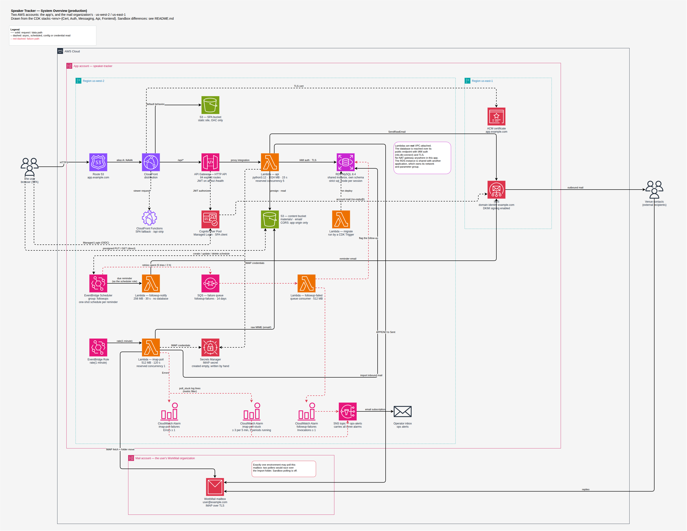

# Speaker Tracker — design and architecture

Speaker Tracker is a production web application built for an independent professional speaker: a
single-user CRM for winning stage and podcast bookings. It tracks venues and the people at them,
moves each gig through a pipeline from research to payment, sends and receives email on the
speaker's own business mailbox, reminds them when to follow up, and measures the week's outreach
against their targets.

**This repository is the documentation only.** The application code is private; these documents are
published from it automatically and describe the system as it is built and running. Account ids,
domains, addresses and names are replaced with placeholders.

Designed and built by **Brian Saastad**.

## How it is built

- **Serverless on AWS, deployed with CDK.** A React SPA on CloudFront and S3; an API Gateway HTTP API
  with 84 explicitly declared routes and a Cognito JWT authorizer, all served by one Python Lambda;
  MySQL 8.4 on a shared RDS instance, reached with IAM authentication. Four more functions handle
  migrations, mail polling, reminders and failed reminders.
- **Layered backend, no ORM.** Handlers parse and respond; `core` holds pure business rules with no
  I/O; repositories own the SQL; Pydantic models carry limits derived from the column widths, and a
  test checks the two still agree.
- **Two-way email on the user's own mailbox.** Mail is sent through SES as the speaker's address and
  copied to their Sent folder; a poller reads the same mailbox over IMAP every minute and threads
  replies back in. The mail client stays a peer, so nothing moves out of the inbox the speaker
  already uses.
- **Built to fail loudly.** Failures are separated by type: bad credentials page someone, a passing
  network blip waits a minute, and a message that will not ingest holds its folder and raises its
  own alarm instead of being skipped. A reminder that cannot be delivered is caught, flagged in the
  app, and alerted on.
- **Tests that prove something.** Repository and handler tests run against a real MySQL schema built
  by the migration runner; infrastructure tests assert the value of each resource, not just that it
  exists; a regression test has to fail against the old code before it counts.

## Problems worth reading about

- **SES rewrites the Message-ID** of every message it sends, so a reply's `In-Reply-To` names an id
  the app never minted. Both ids are stored and matched — [ARCHITECTURE §4](ARCHITECTURE.md#4-email).
- **Making a one-minute IMAP poller safe to repeat:** per-folder UID cursors, `UIDVALIDITY` resets,
  idempotent ingest, and why a stuck message deliberately jams its folder —
  [ARCHITECTURE §4.3–4.4](ARCHITECTURE.md#43-inbound--the-poller) and the
  [email round-trip diagram](diagrams/email-round-trip.png).
- **A shared database with a non-strict server default:** every session sets strict `sql_mode`
  itself and logs what it got — [DECISIONS](DECISIONS.md#data).
- **Rules that must agree across Python and TypeScript** — what counts as money received, fee
  precision, the upload limit, even a log key an alarm filters on — and how each pair points at the
  other — [CODING-GUIDELINES §7](CODING-GUIDELINES.md#7-mirrored-rules).
- **Money that is recorded but never counted:** a fee on a pro-bono or trade gig is kept for tax
  reporting and excluded from every received total — [PRODUCT](PRODUCT.md).

## The documents

| Document | Read it for |
|---|---|
| [PRODUCT.md](PRODUCT.md) | What the app does, the business rules it follows, and what it deliberately does not do |
| [ARCHITECTURE.md](ARCHITECTURE.md) | Request path, backend layers, API routes, email, background work, infrastructure, frontend, CI |
| [DATABASE.md](DATABASE.md) | Every table, why it is shaped that way, and how migrations work |
| [DECISIONS.md](DECISIONS.md) | Why things are the way they are |
| [OPERATIONS.md](OPERATIONS.md) | Deploying, checking a deploy, and the alarm runbooks |
| [CODING-GUIDELINES.md](CODING-GUIDELINES.md) | How the code is written, including the rules mirrored between backend and frontend |
| [BACKLOG.md](BACKLOG.md) | What is not built, not finished, or knowingly imperfect |
| [diagrams/](diagrams/README.md) | Architecture diagrams, as draw.io sources with PNG and SVG exports |

**History, kept for the record** (not maintained): the slice-by-slice
[build plan](archive/DEV-PLAN.md) with each slice's acceptance criteria, the
[UX reconciliation](archive/UX-RECONCILIATION.md) of each page against the approved mockup, and the
[original kickoff prompt](archive/prompt-info.md). [DESIGN.md](DESIGN.md) maps the original design
document's sections to where that material lives now.
